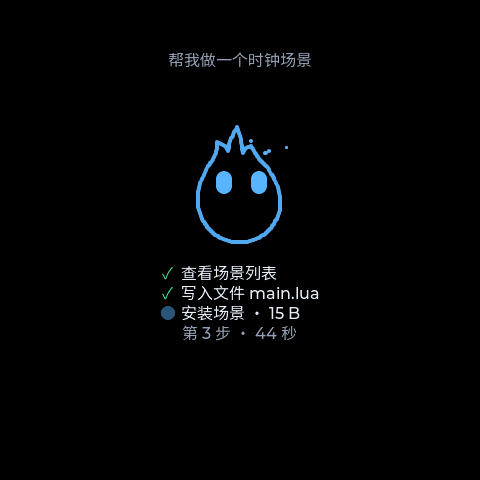
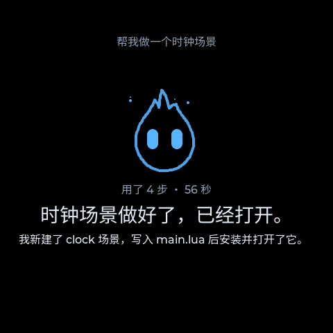
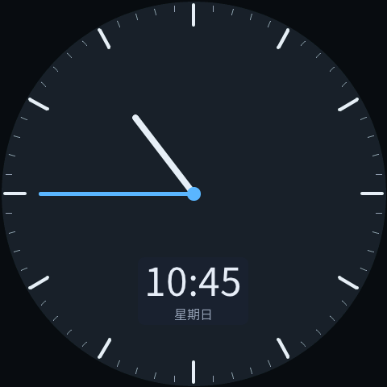
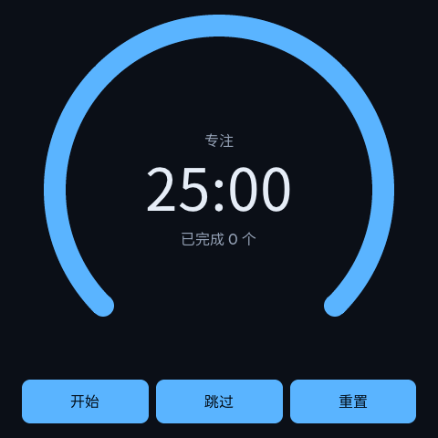
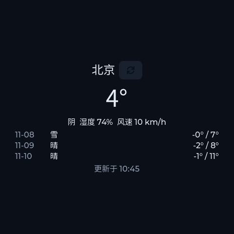
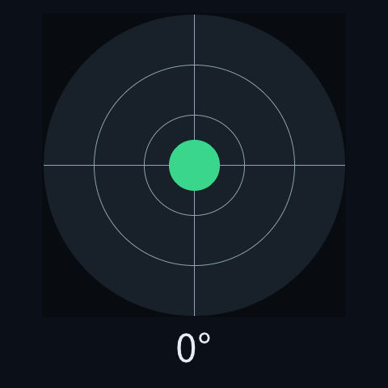
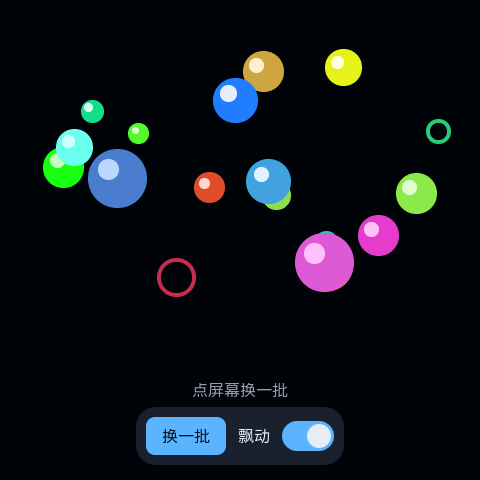

<div align="center">

# 🔥 Wisp

🇺🇸 [English](README.md) | 🇨🇳 [简体中文](README.zh-CN.md) | 🇯🇵 **日本語**

**AI がすべてを動かす手のひらデバイス。アプリはありません。欲しいものを話せば、その場で作ってくれます。**


<table>
  <tr>
    <td align="center"><br><sub>待機中</sub></td>
    <td align="center"><br><sub>エージェントが作業中</sub></td>
    <td align="center"><br><sub>完成</sub></td>
  </tr>
</table>

<sub>端末の画面は日本語・中国語・英語に対応しています。スクリーンショットは中国語表示です。</sub>

</div>

## ✨ Wisp とは

キーを押したまま「ポモドーロタイマーを作って」と話しかけるだけ。エージェントが画面とロジックを書き、インストールして開きます。すべて端末の上で完結し、再コンパイルもパソコンも要りません。作ったものはいつでも開き直せますし、エージェントに手直しを頼むこともできます。

- **頼めばアプリができる**：機能はすべてエージェントが書く Lua のシーンで、変更はすぐに反映されます。
- **エージェントが端末全体を操る**：画面、オーディオ、ストレージ、シーン、設定のすべてがエージェントのツールです。作業の一つひとつが画面に表示されます。
- **あなたを覚える**：好みや ToDo を記憶し、時間になると画面を点けて知らせます。
- **モデルは自由に選べる**：対話・音声認識・音声合成はどれも OpenAI 互換 API で、それぞれ複数の設定を保存して切り替えられます。
- **データは手元に**：管理画面は LAN 内だけで使えます。API キーは書き込み専用で読み出せません。シーンの削除のような大きな操作は端末上で確認します。
- **ボードに縛られない**：ハードウェアは階層的に抽象化されており、開発の大部分は PC のシミュレーターで行えます。

<table>
  <tr>
    <td align="center"><br><sub>時計</sub></td>
    <td align="center"><br><sub>ポモドーロ</sub></td>
    <td align="center"><br><sub>天気</sub></td>
    <td align="center"><br><sub>水準器</sub></td>
    <td align="center"><br><sub>カラーボール</sub></td>
  </tr>
</table>

<sub>どのシーンも <code>main.lua</code> 一つだけで、ほとんどが 200 行未満です。最初の四つのソースは <a href="scenes/examples/"><code>scenes/examples/</code></a> にあります。</sub>

## 👆 使い方

| 操作 | 動作 |
| --- | --- |
| BOOT キーを押し続ける、またはウィスプを長押し | 話しかけます。離すと送信。読み上げ中にもう一度押し続けると中断します |
| 右 / 左 / 下にスワイプ | 設定 / シーン一覧 / 会話履歴。ページは指の動きについてきます |
| シーンの中で BOOT キーを押し続ける | 画面の下に聞き取りバーが現れ、シーンを離れずに話せます |
| 設定 → この端末について → ハードウェア診断 | 各周辺機器の自己診断の結果 |

返答は二層で表示されます。読み上げる一文は大きな文字で、詳細はその下に小さな文字で表示されます。エージェントがツールを呼んだりファイルを書いたりしている間は、いま何をしているかがウィスプの下に一つずつ並びます。

## 🧩 主なモジュール

| モジュール | 説明 |
| --- | --- |
| 🔥 **シェル** | ホーム画面には青い小さな鬼火（ウィスプ）がいます。コードでリアルタイムに描かれ、待機・聞き取り・考え中・発話でそれぞれ表情が変わります。シェルはネイティブ C++ なので、シーンが壊れても必ずホームに戻れます。 |
| 🎭 **シーン** | 機能はすべてシーンです。`scene.json` と、画面を宣言的に書いた `main.lua` からなり、状態が変わると画面が追従します。各シーンは独立した Lua サンドボックスで動き、メモリと実行時間に上限があり、宣言した HTTPS ホストにしかアクセスできません。 |
| 🤖 **エージェント** | プラットフォームツールでシーンの作成・編集・起動・削除、記憶と ToDo の読み書き、端末設定の変更ができます。シーンも独自のツールをエージェントに登録できます。ツールの戻り値はデータとして扱い、命令としては実行しません。 |
| 🎙️ **音声** | 押して話し、離すと文字に起こします。返答の中で `<say>` で示された一文が読み上げられます。スピーカーは優先度で割り当てられ、アラームは読み上げより優先されます。認識と合成はそれぞれ別のサービスを使えます。SiliconFlow がおすすめです。 |
| 🧠 **記憶とリマインダー** | メモと期限付きの ToDo。期限が来ると画面が点いて音が鳴ります。管理画面で確認・削除できます。 |
| 🌐 **管理画面** | ブラウザで `http://wisp.local:8900` を開き、画面に表示される 6 桁のペアリングコードでログインします。ブラウザからのチャット、ネットワーク・モデル・記憶・シーンの管理、ログの閲覧、ファームウェアの更新ができます。管理画面は約 100 KB の素の JavaScript でファームウェアに組み込まれており、日本語・中国語・英語に対応しています。 |

## 🚀 クイックスタート

### 💻 シミュレーター（ハードウェア不要）

```bash
# Arch: sudo pacman -S cmake ninja sdl2 python curl zlib
# Debian/Ubuntu: sudo apt-get install cmake ninja-build libsdl2-dev python3 libcurl4-openssl-dev zlib1g-dev
git clone https://github.com/ShouChenICU/Wisp.git wisp && cd wisp
cmake -S simulator -B build/sim -G Ninja && cmake --build build/sim
./build/sim/wisp_sim
```

指の代わりにマウスを使います。`P` が電源キー、`+` と `-` が音量キー、`S` で SD カードを抜き差しします。ターミナルがシリアルコンソールになっており、`help` でコマンド一覧を表示できます。管理画面は `http://127.0.0.1:8900` です。

<details>
<summary>よく使う起動オプション</summary>

| オプション | 動作 |
| --- | --- |
| `--shape rect\|rounded_rect\|circle` | 画面の形を切り替える |
| `--headless` / `--screenshot <png>` / `--exit-after-ms <n>` | ウィンドウなしで実行、スクリーンショット保存、一定時間後に終了 |
| `--data-dir <dir>` | データディレクトリ（既定は `./sim-data`） |
| `--web-dir <dir>` | ソースツリーから直接管理画面を配信。編集後はリロードするだけ |
| `--no-sd` / `--disable <id>` / `--wifi-fail` | SD カードなし、デバイスの故障、ルーターに届かない状態を再現 |
| `--tap X,Y@MS` / `--swipe X1,Y1,X2,Y2@MS` | 指定時刻にタップ・スワイプ |

</details>

### 📟 実機

現在の対応ボードは **Waveshare ESP32-S3-Touch-AMOLED-2.16** です。480×480 の AMOLED タッチ画面、マイク 2 基、スピーカー、IMU、RTC、電源管理、SD スロットを備え、はんだ付けは要りません。

```bash
. ~/esp/esp-idf-v6.0.3/export.sh        # fish など bash 以外のシェルでは bash -c '...' で包む
cd firmware
idf.py set-target esp32s3
idf.py bmgr -c ../boards -b waveshare_esp32_s3_touch_amoled_2_16
idf.py build && idf.py -p <ポート> flash
```

- **Wi-Fi 設定**：初回起動時に画面の「Wi-Fi 設定を開始」をタップしてスマートフォンで QR コードを読み取るか、シリアルコンソールで `wifi add <SSID> <パスワード>` と入力します。
- **モデル設定**：管理画面の「モデル」ページで、対話・認識・合成それぞれに設定を一つずつ追加し、使用中にします。
- **更新**：
  - コードを変えたら `idf.py app-flash` を実行するか、管理画面で `wisp.bin` をアップロードします（OTA）。
  - フォントを変えたら `idf.py fonts-flash` も実行します。フォントは専用のパーティションにあり、アプリの更新では書き込まれません。

## 🔧 新しいボードへの移植

Wisp は特定のボードに縛られません。ボード固有のものは `boards/<ボード名>/` と `drivers/` だけに置き、その上の層は一切変わりません。リファレンス実装は [`boards/waveshare_esp32_s3_touch_amoled_2_16/`](boards/waveshare_esp32_s3_touch_amoled_2_16/) です。

| 手順 | 内容 |
| --- | --- |
| 1. ハードウェアを記述 | esp_board_manager の YAML にボード、バス、ピンを書きます。画面・タッチ・オーディオ・SD カードはここで宣言します |
| 2. ドライバーを追加 | esp_board_manager が対応していないチップ（IMU、PMU、RTC など）は `drivers/<チップ>/` に C コンポーネントとして書きます |
| 3. `board.cpp` を書く | 各デバイスを `hal::Device` で包んで `DeviceRegistry` に登録し、画面の形・セーフエリア・マイクの有無などの能力を caps で宣言します |
| 4. パーティションと設定 | 規約どおりに `partitions.csv`（OTA、`fonts`、`glyphs`、ストレージ）とボード用の sdkconfig を書きます |
| 5. ビルドと検証 | `-DWISP_BOARD=<ボード名>` でビルドし、起動レポート・デバイス一覧・診断画面を一項目ずつ確認します |

デバイスが見つからなかったり初期化に失敗したりしても、機能が縮退するだけで起動は止まりません。まず画面を点け、ほかの周辺機器は一つずつ足していけます。

> 📖 **詳しい手順は[移植ガイド](docs/porting-guide.md)（英語）にあります。** ボード名の規則、能力フィールド、パーティションの規約、チップごとの違い、受け入れチェックリストまで扱っています。人でも AI コーディングアシスタントでも、作業の前にこのガイドと [`AGENTS.md`](AGENTS.md) を読んでください。そのうえで、[既存のハードウェア資料](docs/hardware/waveshare_esp32_s3_touch_amoled_2_16.md)にならって新しいボードの `docs/hardware/<ボード名>.md` を書いてください。

## 🧱 アーキテクチャ

同じ C++20 のコードから、ESP32-S3 のファームウェアと SDL2 のシミュレーターの二つをビルドします。

```
 wisp_app     起動時の組み立て、シリアルコンソール
 wisp_shell   ホーム画面、ナビゲーション、サブページ、会話の制御
 wisp_agent   会話ループ、ツール登録、コンテキスト管理
 wisp_scene   Lua シーンのランタイム
 wisp_ui      LVGL、ウィスプの描画、システム層、多言語        移植可能な層
 wisp_admin   管理画面の REST / WebSocket                    （下の層にだけ依存）
 wisp_voice   収音、ASR、TTS、再生
 wisp_net     Wi-Fi、ペアリング、HTTP
 wisp_core    イベントバス、デバイス登録、ストレージ、記憶、リマインダー
 wisp_hal · wisp_os · wisp_base
 ───────────────────────────────────────────────
 wisp_port_esp（FreeRTOS + ESP-IDF） │ wisp_port_sim（std::thread + SDL2）
 boards/ ボード定義 · drivers/ チップドライバー
```

設計の原則：

- **階層**：移植可能な層はプラットフォームのヘッダーを読み込まず、上の層にも依存しません。`tools/check_layering.py` が自動で検査します。
- **サービス層**：エージェントのツール、REST、Lua バインディングはどれも同じサービス群の薄いアダプターです。サービスを飛ばしてドライバーを直接触ることはしません。
- **画面の形**：画面は円形や角丸のこともあるので、すべての画面は Display caps が示すセーフエリアに合わせてレイアウトします。
- **メモリ**：内部 SRAM は予算を決めて使い、大きなバッファは PSRAM に置きます。変更のたびにシリアルコマンド `mem` で実機の値を測ります。

詳しくは[アーキテクチャ資料](docs/architecture.md)、[シーン API](docs/scene-api.md)、[ハードウェア資料](docs/hardware/waveshare_esp32_s3_touch_amoled_2_16.md)（いずれも英語）をご覧ください。

## 🗺️ ロードマップ

| | 機能 | 内容 | 状態 |
| --- | --- | --- | --- |
| 🧱 | 基盤 | デバイス抽象化、ストレージ、電源と待機 | ✅ |
| 🌐 | 管理画面 | Wi-Fi と QR での設定、LAN 内の管理画面、複数のモデル設定、ブラウザからのファームウェア更新 | ✅ |
| 🎭 | シーンランタイム | Lua サンドボックス、宣言的 UI、バックグラウンドシーン、通知、シーンファイル | ✅ |
| 🤖 | エージェント | ツール呼び出し、シーンの編集と操作、コンテキスト圧縮、作業ステップのリアルタイム表示 | ✅ |
| 🎙️ | 音声 | 押して話す、音声認識、`<say>` の読み上げ、割り込み | ✅ |
| 🧠 | 記憶とリマインダー | 好みのメモ、期限付き ToDo、リマインダー | ✅ |
| 🔥 | シェル | ウィスプのホーム画面、指に追従するナビゲーション、設定、シーン一覧、会話履歴 | ✅ |
| 🔌 | MCP クライアント | リモートの MCP サーバーにつなぎ、外部のツールやデータソースをエージェントに渡す | 📋 |
| 🗣️ | より自然な音声 | ウェイクワード、ストリーミング認識とリアルタイム字幕、Bailian・Volcano・iFlytek などのストリーミングサービス | 📋 |
| 🐾 | ウィスプとのふれあい | 頭をなでるなどのタッチ操作、表情の追加、カラープリセット、シーンに置けるミニウィスプ | 📋 |
| ⏰ | スケジュールと自動化 | 定時ジョブとイベントルール。時間やイベントに応じてエージェントが自動で実行 | 📋 |
| 📦 | シーンのエコシステム | 書き出しと共有、バージョンのロールバック、よく使うシーンのピン留め、管理画面のシーンエディター | 📋 |
| 🛡️ | 安全性と自己進化 | 権限の段階分けと操作の監査、ロールバックできる範囲で自分のツールやプロンプトを改善 | 📋 |

✅ 完了 · 📋 予定。詳しい TODO は [`docs/backlog.md`](docs/backlog.md) にあります。

## 🤝 コントリビュート

Issue と Pull Request を歓迎します。人も AI コーディングアシスタントも同じ流れで進めます。

1. **まずルールを読む**：プロジェクトのルールと規約は [`AGENTS.md`](AGENTS.md) にあります。読んだうえで、変更に関わる設計 spec を読んでください。
2. **規模に合った流れで**：小さな修正はそのまま PR にできます。新機能やアーキテクチャの変更は、まず spec を書いて合意を取り、それから計画とコードに進みます。
3. **フィーチャーブランチで開発**：テストを先に書き（TDD）、コミット前に `bash tools/ci.sh` をすべて通します。
4. **コミットメッセージ**：Conventional Commits 形式で書きます。
5. **PR の説明**：シミュレーターで確かめたことと実機で確かめたことを、ありのままに書きます。

📖 **詳しい流れ、コードの要件、PR チェックリストは[コントリビュートガイド](CONTRIBUTING.md)（英語）にあります。**

## 📄 ライセンス

Wisp は [Apache-2.0](LICENSE) ライセンスのオープンソースです。利用・参考にしたサードパーティのプロジェクトは [`THIRD_PARTY_NOTICES.md`](THIRD_PARTY_NOTICES.md) と [`docs/references.md`](docs/references.md) に記載しています。
