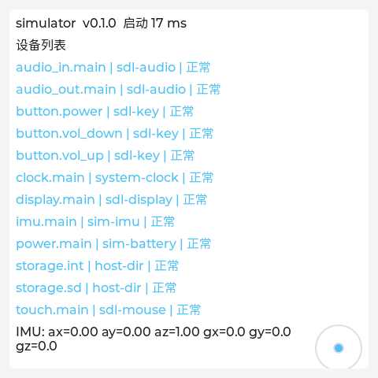

<div align="center">

# Wisp

**一个完全由 AI 驱动的个人掌上 Agent 系统，运行在 ESP32-S3 设备上。**


</div>

> Wisp 掌管设备的一切，同时是你的专属 Agent。你可以向它许愿，“我想要一个待办app”，“我想要个水平仪”，或者“帮我做个2048小游戏”，Wisp Agent 会根据你的需求现场帮你制作独一无二的应用，你可以稍后重新打开它们，也可以随时让 Agent 修改它们，即时生效，不用重新编译或外部计算机参与。

## ✨ 亮点

- **说出需求，就有应用**：Agent 现场编写界面和逻辑，即时生效，无需重新编译。
- **Agent 掌控整台设备**：屏幕、音频、传感器、存储和场景，都是它的工具。
- **模型自由选择**：OpenAI 兼容接口，云端、网关、本地模型皆可，多套配置一键切换。
- **会记住你**：长期记忆偏好与待办，到点主动提醒。
- **数据在你手里**：只在局域网管理，Key 只写不读，危险操作需设备上确认。
- **不绑定板子**：硬件分层抽象，大部分开发在 PC 模拟器完成。

## 🧩 核心模块

### 🔥 小鬼火与系统外壳

主界面是黑色背景上的一团蓝色小鬼火。它会燃烧、飘动，还有一双白色眼睛，在待机、收听、思考、执行工具、输出、充电等状态下，表情和动作都不一样。小鬼火完全用代码实时绘制，不依赖图片素材，在 AMOLED 上只重绘火焰所在的小块区域，能适配不同分辨率和圆形屏。

操作靠手势和一个对话键：

| 操作 | 作用 |
| --- | --- |
| 按住 BOOT 键 | 和 Agent 对话，松开发送；在场景里按住时，底部会浮出收听指示 |
| 主界面右划 / 左划 | 设置页 / 场景列表 |
| 主界面上划 / 下划 | 小鬼火颜色预设 / 对话记录 |
| 场景内从左边缘右划 | 返回主界面 |

外壳用原生 C++ 实现，不是 Lua 场景。这样即使某个场景写坏了，你也总能退回主界面修复它。

### 🎭 场景

Wisp 上的每个功能都是一个场景，由 Agent 编写（也可以手写），以目录形式保存：

```
scenes/<scene_id>/
  scene.json   名称、版本、要访问的网络域名
  main.lua     界面和逻辑
  lib/         可选的其他 Lua 文件
  assets/      图标、图片
  data/        场景自己的数据
```

界面和逻辑都写在一个 `main.lua` 里：用 Lua 表声明控件树，属性绑定到状态，状态一变界面自动更新。

```lua
local count = state(0)

return ui.screen {
  ui.column { pad = "safe", gap = 12, align = "center",
    ui.label { text = bind(count, function(v) return "已点击 " .. v .. " 次" end), font = "xl" },
    ui.button { text = "+1", on_click = function() count:set(count:get() + 1) end },
  },
}
```

每个场景跑在独立的 Lua 5.5 沙箱里，有内存和执行时间上限，写坏了只会弹出错误面板，不影响系统。场景看不到文件系统，只能通过 `wisp.store`（键值和集合）读写自己的数据；联网只能访问 `scene.json` 里声明过的域名，而且必须是 HTTPS。Agent 修改场景时只替换代码，不会动你的数据。场景可以导出分享，也可以连同数据一起备份。后续还会加入后台运行、大文件和版本回滚。

### 🤖 Agent

Agent 通过 OpenAI 兼容接口接入你选的模型，对设备拥有完全的控制权，控制分两层：

- **平台工具**：始终可用，包括创建、修改、打开、删除场景，读写场景代码和数据，截图、读取界面树、模拟点击，调整屏幕、音量等外设。哪怕某个场景卡死，Agent 也能接管和修复。
- **场景工具**：场景可以用 `wisp.tools.register()` 导出自己的工具，比如记账场景导出"记一笔"。场景在前台或后台运行时，它的工具会自动提供给 Agent，所以你在任何地方都能说"记一笔 32 元午饭"。

反过来，场景也能主动找 Agent，比如界面上的"问 AI"按钮或者闹钟到点提醒。场景工具的返回值一律当作数据处理，不会被当成指令执行。删除、外发这类危险操作，无论由谁发起，都必须在设备上确认。

### 🎙️ 语音

按住对话键说话，语音经过断句和识别变成文字交给 Agent，回复以文字流式显示在屏幕上，TTS 朗读可选。麦克风由一条共享的采集管线统一管理；扬声器按优先级分配，比如闹钟优先于 Agent 回复，Agent 回复又优先于背景音乐。

### 🧠 记忆与调度

Agent 会把你的偏好、习惯和待办记在设备上，并且能设置定时任务和事件规则：到点提醒你，或者在某个事件发生时自动执行。

### 🌐 管理后台

设备连上 Wi-Fi 后，在同一局域网的浏览器里打开 `http://wisp.local:8900`，用设备屏幕上显示的配对码登录。后台是一个很小的网页（打包后约 100 KB，直接存在设备里），支持中文、日文和英文：

| 页面 | 能做什么 |
| --- | --- |
| 概览 | 电量、Wi-Fi、存储、运行时长、固件版本，实时刷新 |
| 外设 | 每个设备的状态和能力（caps） |
| 网络 | 当前连接、已保存的网络、扫描并添加网络 |
| 模型 | 对话 / 语音识别 / 语音合成三个标签页，各自管理多套配置：从预设平台新建、测试连接、选择模型、设为当前 |
| 系统 | 亮度、音量、自动熄屏、设备语言；已登录的浏览器；上传固件更新；重启、恢复出厂设置 |
| 日志 | 点一下开始实时滚动，可按级别过滤、暂停 |

安全上的几条底线：

- 后台只在局域网内可用，不经过任何云服务。
- 登录要用设备屏幕上的 6 位配对码，输错 5 次锁定 5 分钟。每个浏览器有自己的令牌，可以随时在系统页撤销。
- API Key 只能写入、不能读出，页面上只显示"已设置"。修改了服务地址的主机却没重新填 Key 时，旧 Key 会被清除，不会发到新地址。
- 恢复出厂设置和固件更新都必须在设备屏幕上点确认才会执行。上传固件不要求签名，自己编译的固件也能装；新固件启动失败时会自动回滚到旧版本。

后台网页以后还会加上场景和数据管理（第 3、6 阶段）。

### 🔋 省电

熄屏后，Wisp 会暂停渲染、关闭不用的传感器、让 CPU 降频并进入浅睡。后台场景（比如播放音乐）只保留自己需要的外设。哪些场景在耗电、从什么时候开始，Agent 和管理后台都能看到。

> 这些模块大多还在设计阶段，进度见下方的[当前状态](#-当前状态)。

## 📦 硬件

目前支持 **Waveshare ESP32-S3-Touch-AMOLED-2.16**：480×480 AMOLED 触摸屏，双麦克风，扬声器，IMU，RTC，电池管理，SD 卡槽，不需要焊接。其他 ESP32-S3 板子可以按[移植指南](docs/porting-guide.md)适配。

## 🚀 快速上手

### 1. 在电脑上运行模拟器

不需要任何硬件，在 Linux 电脑上就能跑一个和真机一样的 Wisp 窗口，连管理后台都一样。

```bash
# Arch Linux
sudo pacman -S cmake ninja sdl2 python curl zlib
# Ubuntu / Debian
sudo apt-get install cmake ninja-build libsdl2-dev python3 libcurl4-openssl-dev zlib1g-dev

git clone https://github.com/ShouChenICU/Wisp.git wisp && cd wisp
cmake -S simulator -B build/sim -G Ninja
cmake --build build/sim
./build/sim/wisp_sim
```

在窗口里用鼠标代替手指；`P` 是电源键（按住 1 秒以上是长按）；`+` 和 `-` 是音量键；方向键模拟倾斜设备；`S` 插拔 SD 卡。

### 2. 打开网页管理后台

模拟器启动后，管理后台已经在 `http://127.0.0.1:8900` 上运行（只监听本机）。

1. 浏览器打开这个地址，点"获取配对码"。
2. 模拟器窗口上会弹出一张卡片，显示 6 位配对码，2 分钟内有效。
3. 把配对码填进网页，就登录了。之后这个浏览器会被记住。
4. 到"模型"页的"对话"标签新建一套配置：选一个平台（比如 DeepSeek），填上 API Key，点"测试连接"，从列表里选一个模型，设为当前。

### 3. 在终端里操作 Wi-Fi

模拟器的终端就是一个串口控制台，直接输入命令回车即可（真机上是 USB 串口）：

```text
help                         列出所有命令
wifi status                  当前连接和已保存的网络
wifi add WispLab wisp1234    添加并连接一个网络
wifi forget WispLab          删除网络
wifi ap on / wifi ap off     开启 / 关闭配网热点
mem                          内存和任务栈占用（仅真机）
```

模拟器里有几个虚拟网络：`WispLab`（密码 `wisp1234`，信号强）、`Neighbor`（信号弱）、`OpenCafe`（无密码）。加 `--wifi-fail` 启动可以模拟路由器不可达。名字里有空格时用双引号括起来；不是 UTF-8 的网络名可以写成 `hex:<十六进制字节>`。输入的密码不会回显，也不会写进日志。

### 4. 刷进真机

需要先安装乐鑫的 ESP-IDF 开发环境，版本固定为 **v6.0.3**。装好后在仓库目录执行：

```bash
. ~/esp/esp-idf-v6.0.3/export.sh
cd firmware
idf.py set-target esp32s3
idf.py bmgr -c ../boards -b waveshare_esp32_s3_touch_amoled_2_16
idf.py build
idf.py -p <串口> flash monitor
```

上电后几秒内会出现自检界面。前面三条准备命令只在第一次构建时需要，之后改了代码只要 `idf.py build` 再刷一次。管理后台网页已经打包在固件里，`flash` 会一并写入引导程序、分区表和固件。

设备连上网之后，也可以不接线更新：在管理后台的"系统"页上传 `firmware/build/wisp.bin`，在设备屏幕上点"是"确认后自动重启；新固件如果没能正常启动，下次开机会自动回滚到旧版本。注意：分区表和引导程序不能通过网页更新。旧版本固件（带 `assets` 分区）的板子要先用 `idf.py -p <串口> flash` 完整烧录一次，设置和数据都会保留。

默认构建的是发布版（`-Os`、日志级别 INFO，渲染相关代码固定用 `-O2`）。需要调试版（`-Og`、DEBUG 日志、开启断言）时这样构建：

```bash
idf.py -B build-debug -D SDKCONFIG=build-debug/sdkconfig \
  -D SDKCONFIG_DEFAULTS="sdkconfig.defaults;components/gen_bmgr_codes/board_manager.defaults;sdkconfig.debug" build
```

`SDKCONFIG_DEFAULTS` 会替换默认列表，所以板级配置 `board_manager.defaults` 必须写上。如果你用的是 fish 等非 bash 终端，需要用 `bash -c '...'` 把命令包起来，因为 `export.sh` 只支持 bash。

### 5. 给真机配网

设备第一次开机时还没有网络，有两种配法：

- **手机扫码（推荐）。** 在自检界面的"网络"区块点"开始配网"，屏幕上会出现二维码。手机扫码就会连上设备的临时热点，并自动弹出配网页；选择你的 Wi-Fi、输入密码，设备连上后屏幕显示新地址，热点大约 30 秒后自动关闭。路由器需要是 2.4 GHz。
- **串口命令。** 在 `idf.py monitor` 里输入 `wifi add <网络名> <密码>`。

连上之后，在同一局域网的浏览器里打开 `http://wisp.local:8900`（或屏幕上显示的 `http://<IP>:8900`），用配对码登录。

---

## 🧱 系统是怎么搭起来的

Wisp 用 C++20 编写，界面基于 LVGL 9.5，真机运行在 ESP-IDF v6.0.3 和 FreeRTOS 上。同一套代码可以编译成两个目标：ESP32-S3 固件，以及基于 SDL2 的 PC 模拟器。绝大部分逻辑都在模拟器里开发和测试，只有少量驱动代码必须上真机验证。

代码分为可移植层和平台层：

```
  firmware/main（真机入口）          simulator/（模拟器入口）
 ─────────────────────────────────────────────────────────
  wisp_app    启动流程、自检界面、电源管理、串口控制台
  wisp_ui     LVGL 对接、UI 线程、设备端多语言
  wisp_admin  管理后台的 REST 路由和 WebSocket 推送
  wisp_net    Wi-Fi 状态机、配对与令牌、HTTP 接口抽象        可移植层
  wisp_core   日志、事件总线、设备注册表、配置、存储、模型配置
  wisp_hal    外设接口和能力描述
  wisp_os     任务、队列、锁、定时器、内存
  wisp_base   Result、Value、JSON
 ─────────────────────────────────────────────────────────
  wisp_port_esp                     wisp_port_sim             平台层
  FreeRTOS + ESP-IDF                std::thread + SDL2
  boards/ 板级定义 + drivers/ 驱动    模拟外设
```

可移植层不能引用任何平台头文件，也不能依赖比自己更高的层。和具体板子有关的引脚、芯片型号、常量都只能出现在 `boards/` 和 `drivers/` 中。这些规则由 `tools/check_layering.py` 自动检查。

几个设计上的要点：

- **设备模型。** 每个外设注册在 `DeviceRegistry` 里，id 形如 `display.main`、`storage.sd`。设备的能力通过 caps 声明，启动时以 `WISP_MANIFEST` 输出，将来 Agent 也靠它了解设备。某个设备初始化失败时，系统会跳过它继续启动。
- **屏幕形状。** 屏幕可能是圆角或圆形的。所有界面都按 Display caps 给出的安全区布局，不写死边距。
- **UI 单线程。** 只有 UI 线程调用 LVGL，其他线程通过 `UiRuntime::post()` 投递任务。调试构建会检查这条约束。
- **内存。** ESP32-S3 的内部 SRAM 只有 512 KB，而且 DMA 缓冲和会访问 Flash 的任务栈只能放在里面，所以把它当作有预算的稀缺资源：Lua 堆、网络缓冲、缓存等大块内存一律放 8 MB 的 PSRAM，不访问 Flash 的任务栈也放 PSRAM。最坏情况（连路由器、开热点、两个 HTTP 服务、日志流、TLS、固件上传同时进行）下内部 RAM 要留出至少 40 KB，用串口命令 `mem` 实测，规则见 [`AGENTS.md`](AGENTS.md)。
- **渲染。** 两块 24 行的刷屏缓冲交替使用，DMA 送屏和下一段渲染同时进行；直接按屏幕的字节序渲染，被不透明卡片挡住的区域不重绘；代码从 PSRAM 执行（XIP），ESP32-S3 上用 SIMD 加速填充和复制。渲染相关代码固定用 `-O2` 编译。
- **存储。** 内置 Flash 用 LittleFS，SD 卡用 FAT，统一由 `StorageManager` 管理，支持热插拔和配额。所有持久化写入都用能承受掉电的两阶段原子写。
- **待机。** `PowerManager` 是屏幕状态的唯一管理者。待机时它会暂停渲染，让屏幕进入睡眠，给 IMU 断电，暂停 SD 卡探测，并允许 CPU 进入浅睡。电量和充电状态通过事件总线发布。
- **服务层。** 网页后台、串口命令以及将来 Agent 的工具，都只是同一组服务（`WifiService`、`PairingService`、模型配置、`SystemSettings`）的薄适配层，不会绕过服务直接操作驱动。
- **网页资源。** 后台网页是不依赖构建工具的原生 JavaScript，构建时由 `tools/pack_assets.py` 打包成一个 WispPack 资源包（上限 256 KB），链接进固件镜像，由设备直接提供（gzip、ETag 缓存）。网页和固件始终是同一个版本，随固件更新一起替换。
- **机器可读输出。** `WISP_BOOT_REPORT`（启动报告）、`WISP_MANIFEST`（设备清单）、`WISP_PERF`（帧率、CPU、刷屏耗时）和 `WISP_HTTP`（后台端口）都是"前缀 + 单行 JSON"，方便脚本和测试解析。

更多细节见 [架构文档](docs/architecture.md)、[移植指南](docs/porting-guide.md) 和 [硬件资料](docs/hardware/waveshare_esp32_s3_touch_amoled_2_16.md)。

### 目录结构

```
components/   可移植层 wisp_base … wisp_app，平台层 wisp_port_esp / wisp_port_sim
web/          管理后台网页（原生 JavaScript，中日英三语）
boards/       板级定义（esp_board_manager YAML + board.cpp）
drivers/      芯片驱动（AXP2101、PCF85063、QMI8658）
firmware/     ESP-IDF 工程
simulator/    PC 模拟器
tests/        GoogleTest 单元测试和模拟器冒烟测试（含管理后台端到端测试）
tools/        ci.sh、check_layering.py、check_i18n.py、pack_assets.py、字体生成脚本
docs/         架构、移植、硬件资料、设计 spec 和实施计划
```

### 模拟器参数

| 参数 | 作用 |
| --- | --- |
| `--headless` | 不打开窗口运行 |
| `--screenshot <path>` | 渲染完成后保存截图（PNG） |
| `--exit-after-ms <n>` | 运行 n 毫秒后退出 |
| `--disable <设备 id 或类别>` | 模拟设备初始化失败，可重复使用 |
| `--no-sd` | 启动时不插 SD 卡 |
| `--data-dir <path>` | 数据目录，默认 `./sim-data` |
| `--shape <rect\|rounded_rect\|circle>` | 模拟不同形状的屏幕 |
| `--http-port <n>` | 管理后台端口，默认 8900；0 表示不启动后台 |
| `--web-dir <path>` | 直接从这个目录提供后台网页，改了网页刷新即可，不用重新构建 |
| `--wifi-fail` | 模拟路由器不可达，用来观察重试和退避 |
| `--tap X,Y@MS` | 第 MS 毫秒在 (X, Y) 点一下，可重复使用 |
| `--swipe X1,Y1,X2,Y2@MS` | 第 MS 毫秒从一点划到另一点，可重复使用 |

标准输入里以 `tap X,Y` 或 `swipe X1,Y1,X2,Y2` 开头的行会立即执行对应的触摸，其余行都当作串口命令。

## 🚧 当前状态

**早期开发中。** 第 1 阶段"系统底座"已经完成：屏幕、触摸、按键、音频、存储、电源管理和待机省电都已就绪，在真机和模拟器上都能跑。第 2 阶段"联网与管理后台"已经全部实现，正在做真机验收：Wi-Fi 与扫码配网、局域网管理后台、多套模型配置、网页上传固件、串口命令，以及设备界面的中日英三语；验收中修掉了内部内存耗尽的问题，并把滑动帧率从约 10 fps 提到 23–28 fps。第 3 阶段"场景运行时"的第一期（Lua 场景、声明式界面、场景数据、开发工具）设计已定，正在另一个分支上实现。Agent 本身从第 4 阶段开始落地。

| 阶段 | 内容 | 状态 |
| --- | --- | --- |
| 1 | 系统底座：设备抽象、存储、电源、自检界面 | ✅ |
| 2 | 联网与局域网管理后台 | 🚧 |
| 3 | 场景运行时（Lua 沙箱、场景包、数据存储） | 🚧 |
| 4 | Agent 核心（工具调用、场景控制） | 📋 |
| 5 | 语音链路（录音、识别、TTS） | 📋 |
| 6 | 记忆与调度 | 📋 |
| 7 | 安全与自我演化 | 📋 |
| 8 | 主界面：一团会动的小鬼火，加上手势导航 | 📋 |

<p align="center">
  <br>
  <sub>当前固件的自检界面</sub>
</p>

## 🛠️ 参与开发

开始之前请先读 [`AGENTS.md`](AGENTS.md)。项目的规则、约定和工作流程都写在那里，人类开发者和 AI 编程助手都要遵守。每个阶段都有设计文档（[`docs/superpowers/specs/`](docs/superpowers/specs/)）和实施计划（[`docs/superpowers/plans/`](docs/superpowers/plans/)），设计文档的优先级最高。

提交前运行完整检查：

```bash
pip install clang-format==23.1.3   # 版本必须和 CI 一致
bash tools/ci.sh
```

它会检查代码格式、分层规则和注释规范，然后构建模拟器并运行全部单元测试和冒烟测试。在主机上运行时，还可以加上 ThreadSanitizer 或 AddressSanitizer 构建，检查线程和内存问题。

提交信息采用 [Conventional Commits](https://www.conventionalcommits.org/) 风格。

## 📄 许可

Wisp 以 [Apache License 2.0](LICENSE) 开源。

部分芯片驱动移植自作者的 MyOS 项目（MIT 许可）。用到和参考的第三方项目登记在 [`THIRD_PARTY_NOTICES.md`](THIRD_PARTY_NOTICES.md) 和 [`docs/references.md`](docs/references.md)。
