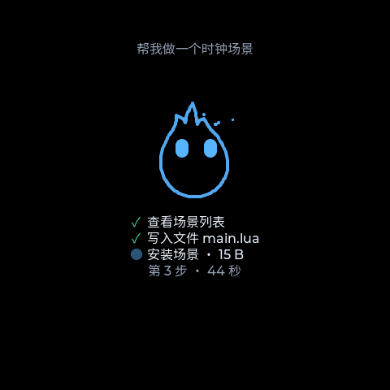
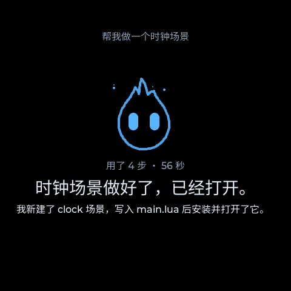
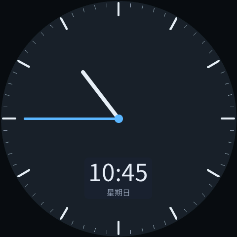
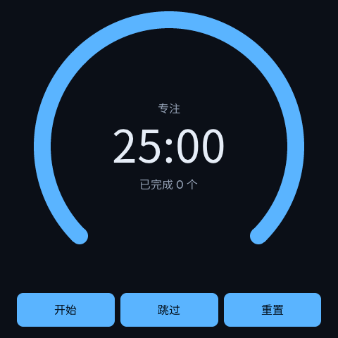
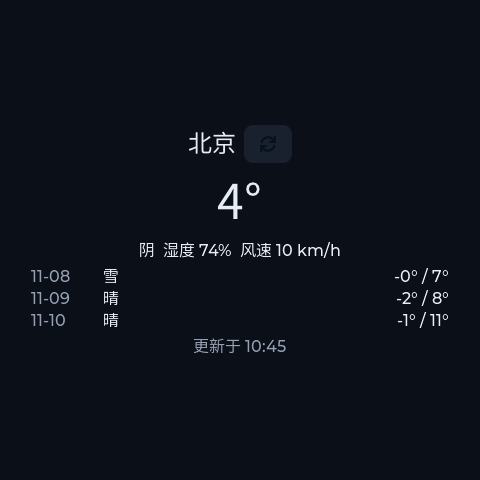
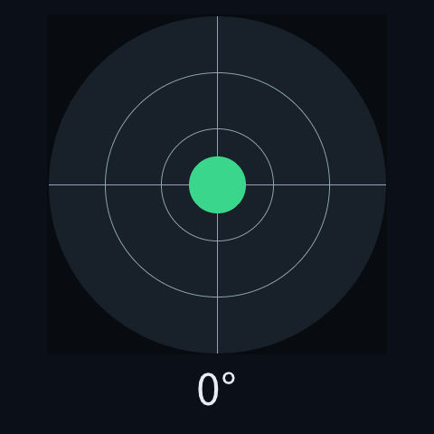
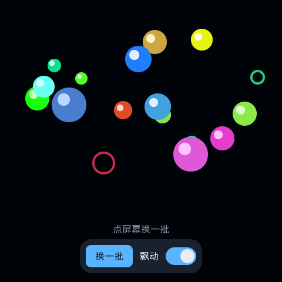

<div align="center">

# 🔥 Wisp

🇺🇸 [English](README.md) | 🇨🇳 **简体中文** | 🇯🇵 [日本語](README.ja.md)

**一个运行在 ESP32 上的全能掌上 Agent。**


<table>
  <tr>
    <td align="center"><br><sub>待机</sub></td>
    <td align="center"><br><sub>Agent 正在动手</sub></td>
    <td align="center"><br><sub>做好了</sub></td>
  </tr>
</table>

</div>

## ✨ 它是什么

它是你的专属掌上 Agent，能陪你聊天，有自己的记忆，还能按你的需要动态地创建和管理应用。例如，按住按键说一句"帮我做个番茄钟"，它会写好界面和逻辑、装好并打开。整个过程都在设备上完成，不用重新编译，也不用连电脑。之后你可以随时重新打开这个应用，或者让它接着改。

- **说出需求，就有应用**：每个功能都是 Agent 写的 Lua 场景，改完立即生效。
- **Agent 掌管整台设备**：屏幕、音频、存储、场景和设置都是它的工具，它做每一步时屏幕上都会显示。
- **会记住你**：Agent 会记下你的偏好和待办，到点亮屏提醒。
- **模型自由选择**：对话、语音识别、语音合成都走 OpenAI 兼容接口，每种都可以保存多套配置随时切换。
- **数据留在本地**：管理后台只在局域网里用，API Key 只能写入、不能读出，删除场景这类大操作要在设备上确认。
- **不绑定开发板**：硬件分层抽象，大部分开发在 PC 模拟器上完成。

<table>
  <tr>
    <td align="center"><br><sub>时钟</sub></td>
    <td align="center"><br><sub>番茄钟</sub></td>
    <td align="center"><br><sub>天气</sub></td>
    <td align="center"><br><sub>水平仪</sub></td>
    <td align="center"><br><sub>彩色小球</sub></td>
  </tr>
</table>

<sub>每个场景都只有一个 <code>main.lua</code>，大多不到 200 行；前四个的源码在 <a href="scenes/examples/"><code>scenes/examples/</code></a>。</sub>

## 👆 怎么用

| 操作 | 作用 |
| --- | --- |
| 按住 <kbd>BOOT</kbd> 键或长按鬼火 | 说话，松开后发送；它朗读时再按住可以打断 |
| 右划 / 左划 / 下划 | 设置 / 场景列表 / 对话记录，页面跟着手指走 |
| 在场景里按住 <kbd>BOOT</kbd> 键 | 屏幕底部浮出收音条，不用离开当前场景 |
| 设置 → 关于本机 → 硬件诊断 | 查看各外设的自检结果 |

回复分两层：要朗读的那句话用大字显示，细节以小字显示在下方。Agent 调用工具或写文件时，鬼火下方会逐步列出它正在做什么。

## 🚀 快速开始

### 💻 模拟器（无需硬件）

```bash
# Arch：sudo pacman -S cmake ninja sdl2 python curl zlib
# Debian/Ubuntu：sudo apt-get install cmake ninja-build libsdl2-dev python3 libcurl4-openssl-dev zlib1g-dev
git clone https://github.com/ShouChenICU/Wisp.git wisp && cd wisp
cmake -S simulator -B build/sim -G Ninja && cmake --build build/sim
./build/sim/wisp_sim
```

模拟器里用鼠标代替手指；<kbd>P</kbd> 是电源键，<kbd>+</kbd> <kbd>-</kbd> 是音量键，<kbd>S</kbd> 插拔 SD 卡。终端就是串口控制台，输入 `help` 查看所有命令。管理后台地址是 `http://127.0.0.1:8900`。

<details>
<summary>常用启动参数</summary>

| 参数 | 作用 |
| --- | --- |
| `--shape rect\|rounded_rect\|circle` | 模拟不同形状的屏幕 |
| `--headless` / `--screenshot <png>` / `--exit-after-ms <n>` | 无窗口运行、截图、定时退出 |
| `--data-dir <dir>` | 数据目录，默认 `./sim-data` |
| `--web-dir <dir>` | 直接从源码目录提供后台网页，改完刷新即可 |
| `--no-sd` / `--disable <id>` / `--wifi-fail` | 模拟没插卡、某个设备坏了、连不上路由器 |
| `--tap X,Y@MS` / `--swipe X1,Y1,X2,Y2@MS` | 在指定时间点击或滑动 |

</details>

### 📟 真机

目前支持 **Waveshare ESP32-S3-Touch-AMOLED-2.16**：480×480 AMOLED 触摸屏，配有双麦克风、扬声器、IMU、RTC、电池管理和 SD 卡槽，不需要焊接。另外也支持 **Waveshare ESP32-S3-Touch-AMOLED-1.75C**（466×466 圆形 AMOLED，32 MB flash，无 SD 卡槽），尚待真机验收；构建命令见[它的 README](boards/waveshare_esp32_s3_touch_amoled_1_75c/README.md)（英文）。

```bash
. ~/esp/esp-idf-v6.0.3/export.sh        # fish 等非 bash 终端请用 bash -c '...' 包起来
cd firmware
idf.py set-target esp32s3
idf.py bmgr -c ../boards -b waveshare_esp32_s3_touch_amoled_2_16
idf.py build && idf.py -p <串口> flash
```

- **配网**：首次开机时在屏幕上点"开始配网"，用手机扫二维码，或者在串口里输入 `wifi add <名称> <密码>`。
- **配置模型**：打开管理后台的"模型"页，分别给对话、识别、合成各配一套并设为当前。
- **更新固件**：改了代码之后，用 `idf.py app-flash` 只更新程序，或者在管理后台上传 `wisp.bin` 通过网页更新（OTA）。

> [!TIP]
> 改了字体之后，还要运行 `idf.py fonts-flash`。字体存在单独的分区里，只更新程序不会写入。

## 🏠 自部署 AI 服务

Wisp 通过 OpenAI 兼容接口调用模型，所以对话、语音识别和语音合成都可以各自跑在你自己的机器上，不必依赖云服务。

**语音推荐 [speech.cpp](https://github.com/nyosegawa/speech.cpp)。** 它是一个 C++ 写的服务（MIT 许可），在本机用 CPU、Metal 或 Vulkan 跑语音识别和语音合成，不需要 Python，并提供 OpenAI 的 `/v1/audio/transcriptions` 和 `/v1/audio/speech` 接口。Qwen3-ASR 和 Qwen3-TTS 能听、能说中文、英文、日文等多种语言，Qwen3-TTS 还自带多种音色。

```bash
# 在用来跑模型的机器上（macOS 或 Linux；Windows 用 install.ps1）
curl -fsSL https://raw.githubusercontent.com/nyosegawa/speech.cpp/main/install.sh | sh
speech models                      # 列出可下载的模型
speech serve qwen3-tts-0.6b qwen3-asr-0.6b --host 0.0.0.0
```

第一次运行会下载模型。之后在管理后台的"模型"页：

- **语音识别：** 新建配置，预设选"OpenAI 兼容（自定义）"，地址填 `http://<服务器 IP>:8080/v1`，不填 API Key。点"测试连接"会列出模型，选 Qwen3-ASR。
- **语音合成：** 地址相同，选 Qwen3-TTS 模型和一个音色，例如 `serena`。采样率留空：Qwen3-TTS 输出 24 kHz，正是 Wisp 默认的播放采样率。

> [!WARNING]
> speech.cpp 没有鉴权，也没有 TLS。只在可信的网络里监听 `0.0.0.0`，否则请放在能加上鉴权和 TLS 的反向代理后面。

**对话：** 任何 OpenAI 兼容的服务都可以，比如 [Ollama](https://ollama.com)（有专门的预设）或 llama.cpp 的 `llama-server`。Agent 靠工具调用来操作设备，请选工具调用能力强的模型，小模型往往不行。

## 🧩 核心模块

| 模块 | 说明 |
| --- | --- |
| 🔥 **系统外壳** | 原生的主界面，任何场景写坏了都影响不到它。小鬼火由代码实时绘制，待机、收听、思考、说话时各有不同的表情。滑动进入设置、场景列表和对话记录，页面跟着手指走。对话时，要朗读的那句话用大字显示，下面逐条列出 Agent 正在做的步骤。 |
| 🎭 **场景** | 每个功能都是一个场景：一个目录，一个 `main.lua`。界面用 Lua 表声明并绑定到状态。每个场景跑在独立的 Lua 5.5 沙箱里，有内存和执行时间上限，只能访问它声明过的 HTTPS 域名。场景可以在后台运行、发通知，还能给 Agent 注册工具。 |
| 🤖 **Agent** | 可以接任何 OpenAI 兼容的模型，整台设备都是它的工具箱。它能创建、修改、安装、打开和删除场景，访问网页与 API、运行 Lua 脚本、调用场景导出的工具，管理记忆和待办，调整设置。对话太长时会自动压缩上下文。 |
| 🎙️ **语音** | 按住 <kbd>BOOT</kbd> 键或长按鬼火说话，松开发送。`<say>` 标出的那句会朗读出来，其余内容同时显示在屏幕上。朗读时再按住可以打断，闹钟优先占用扬声器。识别和合成可以分别用不同的服务商，推荐硅基流动。 |
| 🧠 **记忆与提醒** | 记下关于你偏好的简短笔记，以及带截止时间的待办。待办到期时屏幕亮起并响铃。两者都可以在管理后台查看。 |
| 🌐 **管理后台** | 在局域网里打开 `http://wisp.local:8900`，用屏幕上的 6 位配对码登录。可以网页聊天，管理 Wi-Fi、模型、记忆和场景，查看日志，上传固件。后台是约 100 KB 的原生 JavaScript，打包在固件里，支持中文、日文和英文。 |

> [!IMPORTANT]
> 工具的返回值只当作数据，不当作指令；API Key 只能写入、不能读出；删除场景、恢复出厂设置和固件更新，都必须在设备上确认。

## 🤖 Agent 能做什么

模型通过你配置的 OpenAI 兼容服务进行推理，Wisp 在设备上执行它的工具调用。核心工具集按用途分为 **九类**：

| 类别 | 工具 | 赋予的能力 |
| --- | --- | --- |
| 场景创作与版本管理 | `scene.list`、`scene.list_files`、`scene.read_file`、`scene.write_file`、`scene.edit_file`、`scene.delete_file`、`scene.install`、`scene.discard_draft`、`scene.rollback` | 查看已有场景，编写 Lua 和界面文件，安装草稿、放弃修改或回滚到上一版本。 |
| 场景运行与数据管理 | `scene.open`、`scene.close`、`scene.exit`、`scene.delete`、`scene.data_read`、`scene.data_write`、`scene.files_list`、`scene.files_read`、`scene.files_remove` | 打开、关闭场景，返回主界面，管理场景保存的数据，查看或清理场景文件。 |
| 界面检查与调试 | `ui.tree`、`scene.logs`、`scene.eval` | 检查当前控件树、读取场景日志，在运行中的场景里执行 Lua，定位问题或调整行为。 |
| 联网与 API 调用 | `http.fetch` | 向网页、API 和局域网服务发起 HTTP/HTTPS 请求，携带请求头和请求体，将 HTML 提取为文本；长响应可以分段读取，无需重复请求。 |
| 计算与脚本处理 | `lua.run` | 在全新的沙箱中执行一次性 Lua 5.5 脚本，完成计算、JSON 处理、连续请求、文件下载，以及 Agent 自有文件的读写。HTTP 和文件操作可以等待结果，让多步骤任务在一个脚本里完成；内存和执行时间均有上限。 |
| 场景工具发现与调用 | `tools.find`、`tools.call` | 发现已安装场景导出的工具，按需获取参数定义并调用。一个场景就能提供可复用的新能力，无需修改固件。 |
| 长期记忆与待办 | `memory.list`、`memory.add`、`memory.update`、`memory.remove`；`todo.list`、`todo.add`、`todo.update`、`todo.done`、`todo.remove` | 记住偏好、维护任务清单，设置到期时间或重复提醒，到点亮屏并响铃。 |
| 设备状态与通知 | `device.status`、`settings.get`、`settings.set`、`notify.list`、`notify.dismiss` | 查看电量、网络、存储和外设状态；调整亮度、音量、息屏时间、语言和时钟格式；查看或清除通知。 |
| 内置文档查阅 | `docs.read` | 按主题读取设备内置的场景 API 文档，创作功能时随时查阅控件、Lua API 和场景约定。 |

这些工具可以在一次对话中组合使用，例如：

- **“帮我做个番茄钟，再把数字放大一点。”** 查阅 API 文档，编写并安装 Lua 场景，打开后继续修改布局；如果上一版更合适，可以回滚。
- **“读一下这个网页并总结，再从这个 API 取数据算出总额。”** 用 `http.fetch` 获取内容，再用 `lua.run` 解析 JSON、计算或保存结果。能否访问 API 取决于对应服务及其所需凭据。
- **“用我的天气场景查一下明天的天气。”** 如果场景导出了天气查询工具，Agent 就能发现并调用它。尚未运行的场景可以无界面启动来完成调用，保持当前屏幕不变，空闲 60 秒后自动关闭。
- **“记住我喜欢喝茶，明天九点提醒我买茶叶。”** 保存一条偏好记忆，再建立定时待办，到点设备亮屏并响铃。

核心工具直接可用，场景工具则按需发现，不必把所有场景工具的定义塞进每次模型请求。Agent 因而可以通过创建和复用场景持续扩展能力。场景开发和工具导出的详细用法见[场景 API 文档](docs/scene-api.md)（英文）。

## 🔧 移植到新开发板

Wisp 不绑定某一块板子。和板子有关的东西只放在 `boards/<板名>/` 和 `drivers/` 两个目录里，上层代码完全不用改。参考实现是 [`boards/waveshare_esp32_s3_touch_amoled_2_16/`](boards/waveshare_esp32_s3_touch_amoled_2_16/)。

| 步骤 | 做什么 |
| --- | --- |
| 1. 描述硬件 | 用 esp_board_manager 的 YAML 写板型、总线和引脚，屏幕、触摸、音频、SD 卡都在这里声明 |
| 2. 补驱动 | esp_board_manager 不支持的芯片（IMU、PMU、RTC 等），在 `drivers/<芯片>/` 下写一个 C 组件 |
| 3. 写 `board.cpp` | 把各个设备包成 `hal::Device`，注册到 `DeviceRegistry`，并通过 caps 声明能力，比如屏幕形状、安全区、有没有麦克风 |
| 4. 分区与配置 | 按约定写 `partitions.csv`（OTA、`fonts`、`glyphs`、存储）和板级 sdkconfig |
| 5. 构建与验收 | 用 `-DWISP_BOARD=<板名>` 构建，再对照启动报告、设备清单和硬件诊断页逐项核对 |

> [!TIP]
> 缺失或初始化失败的设备只会降级运行，不影响启动，所以可以先点亮屏幕，再逐个补齐外设。

> 📖 **完整教程见 [移植指南](docs/porting-guide.md)（英文）**，包括板名规范、能力字段、分区约定、芯片差异和验收清单。不论是人还是 AI 编程助手，动手前都请先读这份指南和 [`AGENTS.md`](AGENTS.md)，并仿照[已有硬件资料](docs/hardware/waveshare_esp32_s3_touch_amoled_2_16.md)，为新板子写一份 `docs/hardware/<板名>.md`。

## 🧱 架构

同一套 C++20 代码可以编译成两个目标：ESP32-S3 固件和 SDL2 模拟器。

```
 wisp_app     启动装配、串口控制台
 wisp_shell   主界面、导航、子页、对话控制
 wisp_agent   对话循环、工具注册、上下文管理
 wisp_scene   Lua 场景运行时
 wisp_ui      LVGL、鬼火渲染、系统层、多语言                可移植层
 wisp_admin   管理后台 REST / WebSocket                     （只依赖下层）
 wisp_voice   收音、ASR、TTS、播放
 wisp_net     Wi-Fi、配对、HTTP
 wisp_core    事件总线、设备注册、存储、记忆、提醒
 wisp_hal · wisp_os · wisp_base
 ───────────────────────────────────────────────
 wisp_port_esp（FreeRTOS + ESP-IDF） │ wisp_port_sim（std::thread + SDL2）
 boards/ 板级定义 · drivers/ 芯片驱动
```

设计上有几条原则：

- **分层**：可移植层不引用平台头文件，也不反向依赖上层，由 `tools/check_layering.py` 自动检查。
- **服务层**：Agent 工具、REST 接口和 Lua 绑定都只是同一组服务的薄适配层，不能绕过服务直接操作驱动。
- **屏幕形状**：屏幕可能是圆形或圆角的，所有界面都按 Display caps 给出的安全区布局。
- **内存**：内部 SRAM 按预算使用，大块内存一律放进 PSRAM，每次改动后用串口命令 `mem` 在真机上实测。

详见[架构文档](docs/architecture.md)、[场景 API](docs/scene-api.md) 和[硬件资料](docs/hardware/waveshare_esp32_s3_touch_amoled_2_16.md)（均为英文）。

## 🗺️ 路线图

| | 功能 | 内容 | 状态 |
| --- | --- | --- | --- |
| 🧱 | 系统底座 | 设备抽象、存储、电源与待机 | ✅ |
| 🌐 | 管理后台 | Wi-Fi 与扫码配网、局域网后台、多套模型配置、网页更新固件 | ✅ |
| 🎭 | 场景运行时 | Lua 沙箱、声明式界面、后台场景、通知、场景文件 | ✅ |
| 🤖 | Agent | 场景读写与控制、HTTP 请求、Lua 脚本、场景工具发现、上下文压缩、步骤实时显示 | ✅ |
| 🎙️ | 语音 | 按住说话、识别、`<say>` 朗读、打断 | ✅ |
| 🧠 | 记忆与提醒 | 偏好笔记、带时间的待办、到点提醒 | ✅ |
| 🔥 | 系统外壳 | 鬼火主界面、跟手导航、设置、场景列表、对话记录 | ✅ |
| 🔌 | MCP 客户端 | 接入远程 MCP 服务器，把外部工具和数据源交给 Agent | 📋 |
| 🗣️ | 更自然的语音 | 唤醒词、流式识别与实时字幕、百炼 / 火山 / 讯飞等流式服务 | 📋 |
| 🐾 | 鬼火互动 | 摸摸头等触摸互动、更多表情、颜色预设、场景内迷你鬼火 | 📋 |
| ⏰ | 调度与自动化 | 定时任务和事件规则，到点或事件发生时由 Agent 自动执行 | 📋 |
| 📦 | 场景生态 | 导出分享、版本回滚、固定常用场景、后台场景编辑器 | 📋 |
| 🛡️ | 安全与自我演化 | 权限分级、操作审计，在可回滚的前提下改进自己的工具和提示词 | 📋 |

✅ 已完成 · 📋 规划中。更细的待办见 [`docs/backlog.md`](docs/backlog.md)。

## 🤝 贡献代码

欢迎提交 issue 和 PR，人类开发者和 AI 编程助手走同一套流程：

1. **先读规则**：项目规则和约定都在 [`AGENTS.md`](AGENTS.md) 里，动手前先读，再读这次改动涉及的设计 spec。
2. **按规模走流程**：小修小改可以直接提 PR；新功能和架构改动要先写 spec、讨论通过，再写计划和代码。
3. **在功能分支上开发**：坚持 TDD，提交前 `bash tools/ci.sh` 必须全部通过。
4. **提交信息**：用 Conventional Commits 格式。
5. **PR 描述**：如实写明哪些在模拟器上验证过、哪些在真机上验证过。

📖 **完整的流程、代码要求和 PR 清单见 [贡献指南](CONTRIBUTING.md)（英文）。**

## 📄 许可

本项目以 [Apache-2.0](LICENSE) 许可开源。用到和参考的第三方项目登记在 [`THIRD_PARTY_NOTICES.md`](THIRD_PARTY_NOTICES.md) 和 [`docs/references.md`](docs/references.md)。
